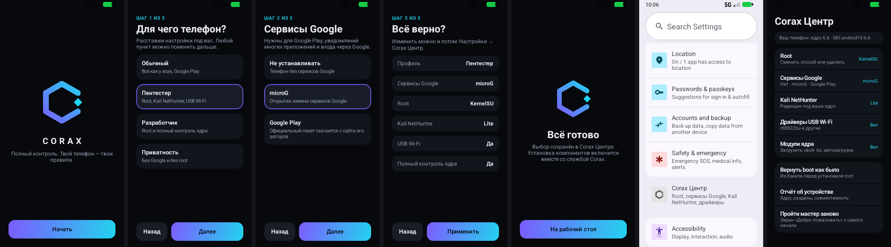
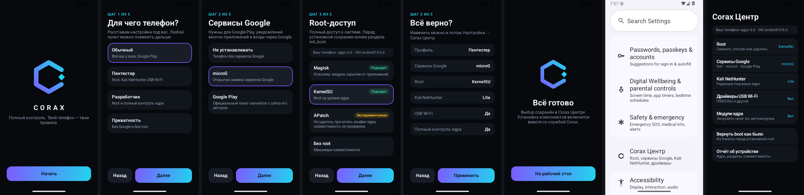
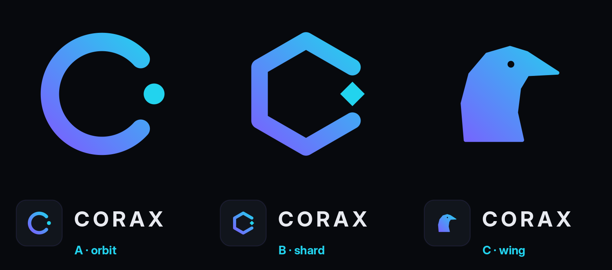

# Corax OS

> Имя, цвета и логотип (вариант B) задаются в одном файле: [`brand/brand.json`](brand/brand.json).

Своя прошивка на **Android 17** для всех arm64‑телефонов с Project Treble (GSI). База: LineageOS 24 + TrebleDroid. Своё имя, логотип и загрузочная анимация, полный контроль над телефоном.

**Статус: ранняя разработка.** Устанавливаемого образа пока нет. План и прогресс: [`plans/pending/android17-gsi-gki.md`](plans/pending/android17-gsi-gki.md).

<p align="center">
  
</p>

## Что будет
- **Мастер первого включения с анимациями:** язык, Wi‑Fi, «для чего телефон» (Обычный / Пентестер / Разработчик / Приватность), сервисы Google (нет / microG / Google Play), root (Magisk / KernelSU / APatch / без root), наборы (Kali NetHunter, драйверы USB Wi‑Fi).
- **Corax Центр в Настройках:** всё то же самое в любой момент, плюс загрузка своих модулей ядра, бэкап и восстановление `boot`, отчёт о совместимости.
- **Подстраивается под телефон:** система определяет ядро и железо и предлагает только то, что заработает. Например, сама выбирает редакцию Kali NetHunter: полную, Lite или Rootless.
- **Установка:** fastboot, TWRP, OrangeFox, adb sideload, DSU (попробовать без стирания данных).
- **Всё собирается на GitHub** (GitHub Actions).

## Проверка в эмуляторе
Снято автоматически на GitHub (плагин android-emulator-qa).

GSI Android 17 с изменениями Corax OS, загруженный в эмуляторе (`emu-gsi.yml`):



Мастер первого включения и Corax Центр (`qa.yml`):



## Логотип
Выбран вариант **B (shard)**. Остальные варианты оставлены для истории.


## Документация
- [Минимальные требования](docs/requirements.md)
- [Установка](docs/install.md)
- [Откат](docs/rollback.md)

## Структура
```
brand/          имя, цвета, логотип (SVG → PNG), генератор загрузочной анимации
docs/           требования, установка, откат
plans/          план разработки
.github/        сборки GitHub Actions
```

## Собрать бренд локально
```bash
pip install pillow numpy cairosvg
python3 brand/tools/logo.py --sheet docs/img/logo-variants.png
python3 brand/bootanim/build.py --preview brand/out/bootanimation-preview.mp4
python3 brand/bootanim/check.py brand/out/bootanimation.zip
```

## Лицензия
Код проекта — Apache 2.0 ([LICENSE](LICENSE)). Сторонние компоненты и товарные знаки — в [NOTICE](NOTICE).
